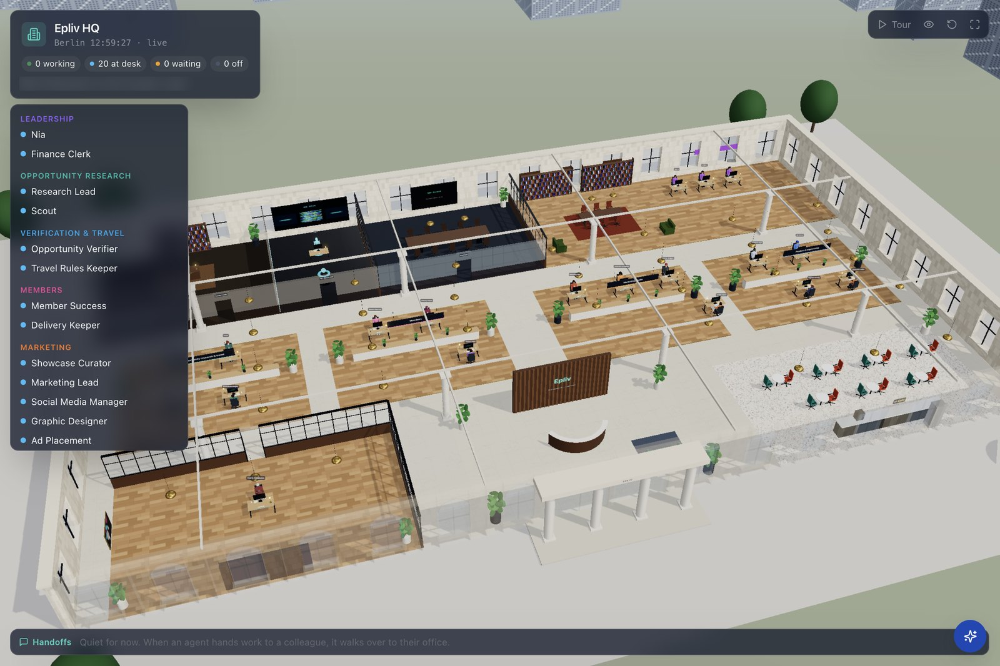
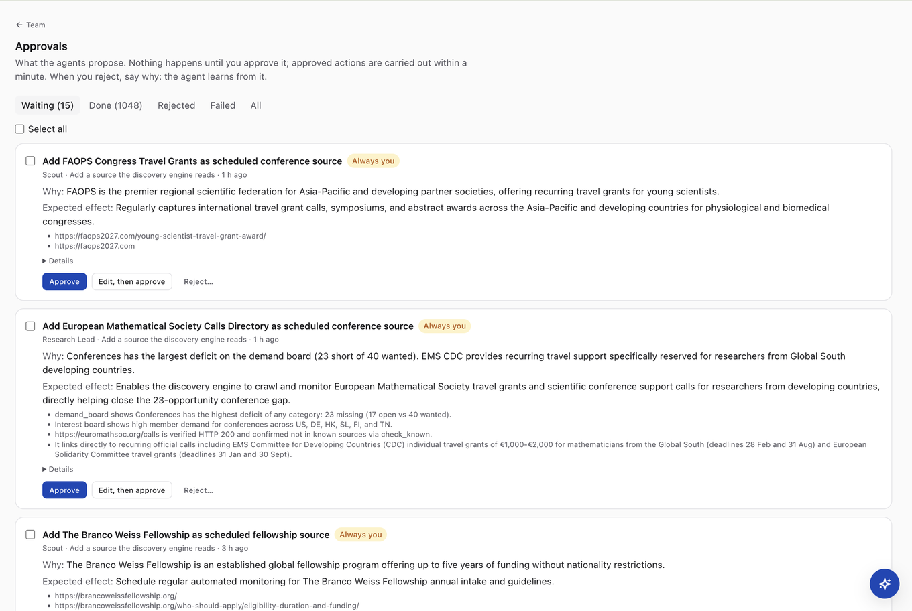
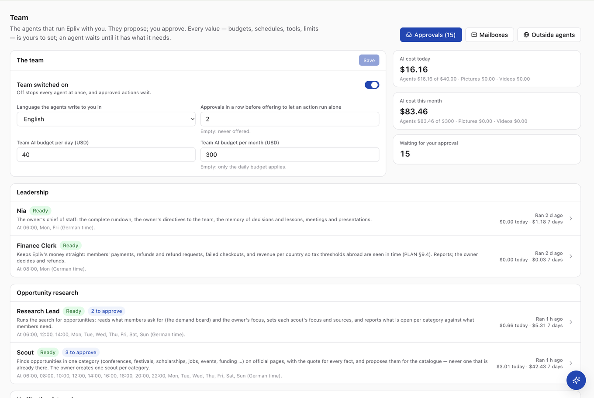
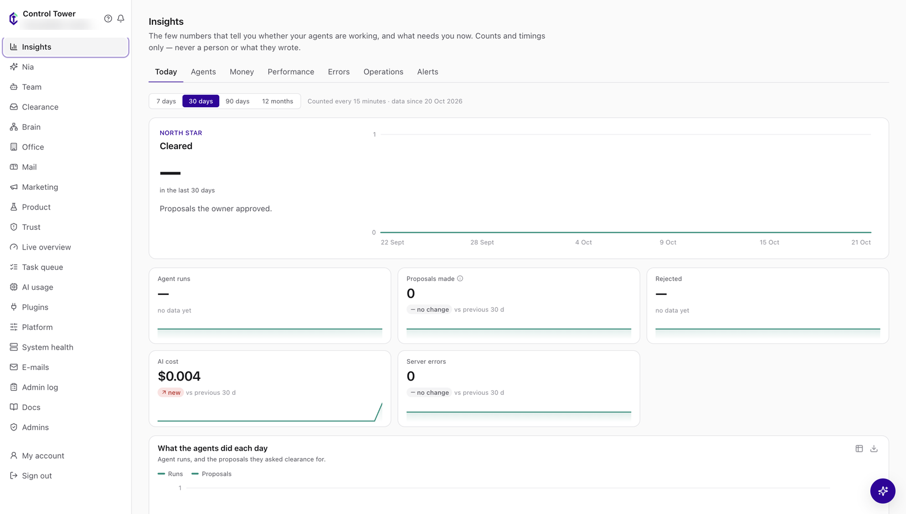
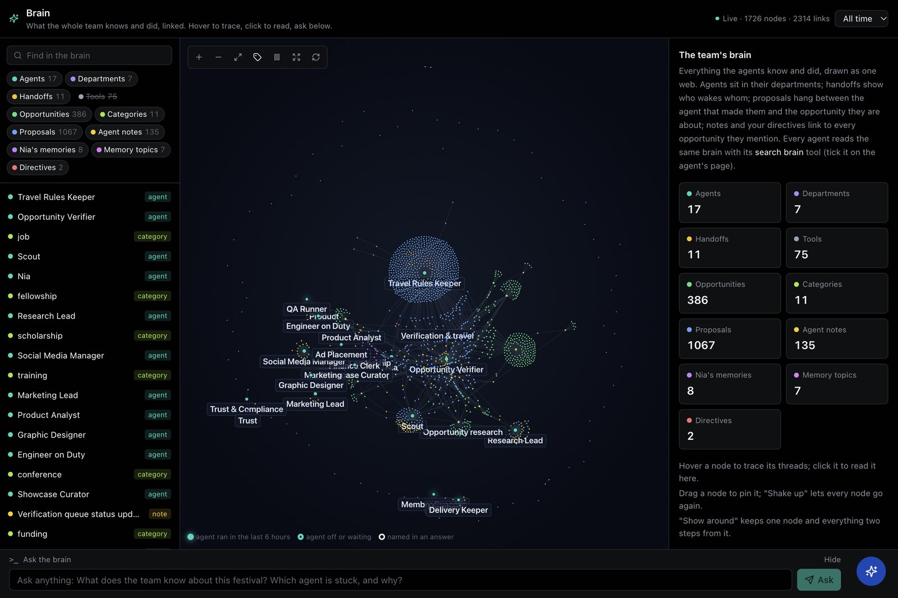
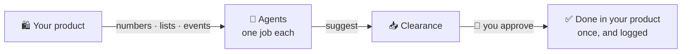

<p align="center">
  <picture>
    <source media="(prefers-color-scheme: dark)" srcset="https://raw.githubusercontent.com/CrowPus/control-tower/main/docs/images/logo-dark.png">
    
  </picture>
</p>

<h3 align="center">Your own AI team, on your own server.</h3>

<p align="center">
  Build AI agents that watch your product, report what matters and suggest what to do —<br>
  and nothing happens until you say yes.
</p>

<p align="center">
  <a href="https://github.com/CrowPus/control-tower/actions/workflows/ci.yml"></a>
  <a href="LICENSE"></a>
  
  
  
</p>

<p align="center">
  <a href="#quick-start"><b>Quick start</b></a> ·
  <a href="docs/GUIDE.md"><b>The guide</b></a> ·
  <a href="#connect-your-product">Connect your product</a> ·
  <a href="#how-it-works">How it works</a> ·
  <a href="#documentation">Docs</a>
</p>

<p align="center">
  
  <br>
  <sub>The live office of <b>Epliv</b>, a company run with Control Tower: each agent at its own desk, grouped by department, working, waiting or off.</sub>
</p>

---

## Why Control Tower

You built a product. Now you also run it — the numbers, the customers, the failures at 3 a.m., the marketing, the
follow-ups. Control Tower gives you a team for that, without handing your business to a black box.

| | |
| --- | --- |
| **🧑‍💼 Your agents, your design** | Create as many agents as you need, each with one job — from a blank page or a starter template (Marketing Lead, Product Analyst, Researcher, Engineer on Duty, Revenue Watcher …). Nia, your chief of staff, is there from day one. |
| **✋ You stay in charge** | Agents only *suggest*. Every suggestion waits in **Clearance** for your yes or no; money, deleting and settings always need you. Budgets per agent and for the team, one switch stops everything, and everything is logged. |
| **🔌 Your product, connected** | Agents see your real numbers, lists and events — from any app or website, in any language. Stripe and a read-only database connection are ready to use. Your coding agent can build the connection for you. |
| **🏠 Yours, end to end** | Self-hosted with Docker: your data and keys stay on your server. Bring your own AI — Gemini, Claude or OpenAI. Open source (AGPL-3.0). |

## See it

<table>
  <tr>
    <td colspan="2" valign="top">
      
      <p><b>Clearance</b> — every suggestion waits for you, with why the agent makes it, what it expects, and the evidence. Approve, edit, or reject and say why: the agent learns from it. <sub>(Epliv, where it is called Approvals: 15 waiting, 1,048 done.)</sub></p>
    </td>
  </tr>
  <tr>
    <td width="50%" valign="top">
      
      <p><b>Your team</b> — each agent with its job, its schedule and what it cost today and this week, under a daily and monthly budget you set. One switch stops them all. <sub>(Epliv's team.)</sub></p>
    </td>
    <td width="50%" valign="top">
      
      <p><b>Insights</b> — the few numbers that tell you whether your agents are working: what they did, what you cleared, what it cost. Your product's own numbers sit next to them.</p>
    </td>
  </tr>
  <tr>
    <td colspan="2" valign="top">
      
      <p><b>The Brain</b> — everything the team knows and did, as one web you can search and ask. Every agent reads it before it works. <sub>(Epliv's brain, after a few weeks: 1,726 things and 2,314 links.)</sub></p>
    </td>
  </tr>
</table>

Also inside: **Nia** by text or voice, team **chat** with any agent, a **mail client** for the agents'
mailboxes, a **marketing studio** (pictures and short videos), **Trust** reviews of the agents' work, and a
**gateway** (MCP) so outside agents like Claude Code or ChatGPT can join your team under the same rules.

## How it works



1. **Connect your product.** A small, signed connection lets agents read what you choose — sign-ups, orders, failed
   payments — and lets your product tell them when something happens.
2. **Make agents.** Give each a job, the tools it may use, a budget and a schedule. It starts switched off.
3. **Clear what they suggest.** Approve, reject (they learn why) or edit. After enough approvals in a row, an agent may
   offer to handle a kind of task alone, within a daily limit you set.

Personal data your product marks as personal — e-mail addresses, names, phone numbers — never reaches an agent.

## Quick start

You need a Linux server with [Docker](https://docs.docker.com/engine/install/) and Compose v2 (about 300 MB of memory
when idle; 2 GB free to build).

```bash
git clone https://github.com/CrowPus/control-tower.git
cd control-tower
./install.sh
```

The installer asks five questions, sets everything up with strong secrets, and prints **a link** to set your password
and authenticator app. Then **Getting started** walks you through it:

1. **Your company** — what it does and for whom; every agent reads this first.
2. **Your AI** — Gemini, Claude or OpenAI, with your own key; press *Test*.
3. **Your team** — switch it on and set a daily budget.

Then **connect your product** and **make your first agent**. New to all this? [The guide](docs/GUIDE.md) explains every
step in plain words.

<details>
<summary><b>Open it from anywhere: your domain, an SSH tunnel, or your own computer</b></summary>

<br>

Control Tower listens only on its own machine (`127.0.0.1:8000`; another port with `APP_PORT` in `.env`).

- **Trying it on your own computer:** install with `--address http://localhost:8000` and open that address.
- **On a server, only for you:** an SSH tunnel — `ssh -L 8000:127.0.0.1:8000 you@your-server` — then open
  `http://localhost:8000` (install with that address).
- **On a server, at your own domain:** a reverse proxy with HTTPS in front of it. With [Caddy](https://caddyserver.com),
  which gets the certificate by itself, the whole configuration is:

  ```
  tower.example.com {
      reverse_proxy 127.0.0.1:8000
  }
  ```

  Install with `--address https://tower.example.com`. To let only your own addresses open the admin, set
  `ADMIN_IP_ALLOWLIST` in `.env` (the agent gateway and the links projects use stay reachable).

The installer can run without questions:
`./install.sh --email you@example.com --name "Your Name" --address https://tower.example.com --time-zone Europe/Berlin --yes`.
Run it again at any time: it keeps your secrets and data. Lost the sign-in link?
`docker compose exec app /app/backend/.venv/bin/python -m app.admin_cli invite-again --email you@example.com`.

E-mail (admin invitations, alerts, the Monday report) uses the SMTP settings in `.env`; without them, alerts appear in
the admin's bell.

</details>

## Connect your product

In the admin: **Plugins → Connect your project**. It asks what your product is and shows the way that fits:

| Your product | The way | Who does the work |
| --- | --- | --- |
| Payments on **Stripe** | The ready Stripe plugin, with a read-only key | You — 5 minutes |
| Numbers from your **database** (PostgreSQL, MySQL) | The ready Database plugin: you write the questions, agents can only ask those | You or a developer — 30 minutes |
| An **app or website**, any language | A small signed connection added to your product | **Your coding agent** (Claude Code, Cursor, Copilot, Lovable …) or a developer |
| **Python**, on the same server | A Python plugin | A developer |

For an app or website, Control Tower hands you **the exact message for your coding agent** and **a complete brief** to
save in your project — then **Check the connection** tells you, in plain words, whether it works or what to fix.
Developers and coding agents: [the brief](docs/CONNECT-A-PROJECT.md), [the reference](docs/PLUGINS.md), and a complete
example in [examples/plugins/hello_shop](examples/plugins/hello_shop/plugin.py).

## Safe by design

- **Agents propose, code acts.** Nothing an AI writes is carried out without a check and, where you set it, your
  clearance — and each cleared action runs once.
- **Hard limits.** Budgets per agent, for the team and for the whole install; a daily cap on what an agent may do alone;
  a stop switch for everything.
- **Private by default.** Personal fields are hidden from agents; keys are stored encrypted; the admin needs a password
  and an authenticator; every request between Control Tower and your product is signed.
- **Accountable.** Every proposal, decision and change is in the Admin log.

## Bring your own AI

Choose **Google Gemini**, **Anthropic Claude** or **OpenAI** — or any service that speaks OpenAI's API (OpenRouter, a
model on your own machine) — in *Platform → AI*, with your own key, models and prices, and a test button. Pictures,
videos, Nia's voice, Nia's browser and web search use Gemini, whichever provider thinks.

## Running it

<details>
<summary><b>Backups, updates and optional parts</b></summary>

<br>

```bash
./scripts/backup.sh            # database, files and settings into backups/ (add --media for the studio's videos)
./scripts/restore.sh backups/ct-20261020-030000
./scripts/update.sh            # backs up first; goes back by itself if the new version does not start
```

The installer shows the line that makes a backup every night. Backups are kept 14 days (`BACKUP_KEEP_DAYS`);
`BACKUP_COPY_COMMAND` in `.env` copies each one elsewhere (for example with rclone). A backup holds a copy of `.env`,
so keep backups as safe as `.env` itself.

- **Nia's browser** (Nia browses the web for you, live-watched): `docker compose --profile browser up -d`.
- **Virus scanning** of files attached in chats and mail: `docker compose --profile clamav up -d`, then
  `CLAMD_HOST=clamav` in `.env` (needs about 1.5 GB of memory).

</details>

<details>
<summary><b>Develop</b></summary>

<br>

```bash
cd backend && uv sync --all-extras && cd ..
npm install
cp .env.example .env            # EXECUTION_MODE=development, DATABASE_ENGINE=sqlite; set ENCRYPTION_SECRET
cd backend && uv run python -m app.prestart
uv run python -m app.admin_cli create-owner --email you@example.com --name "Your Name"
uv run uvicorn app.main:app --port 8000 &
cd .. && npm run dev            # the admin on http://127.0.0.1:5174
```

Tests: `cd backend && uv run pytest`. Notes for contributors and coding agents: [AGENTS.md](AGENTS.md). The plan and
what was built: [docs/PLAN.md](docs/PLAN.md), [docs/BUILD_LOG.md](docs/BUILD_LOG.md).

</details>

## Documentation

| | |
| --- | --- |
| [**The guide**](docs/GUIDE.md) | Control Tower in plain words: your first hour, the words it uses, what to do when something is wrong. |
| [**Connect a project**](docs/CONNECT-A-PROJECT.md) | The brief for your coding agent or developer, with ready code for Node and Python. |
| [**Plugins**](docs/PLUGINS.md) | The full reference: tools, actions, numbers, events, signing. |
| **In the admin** | *Docs* explains every page — and Nia answers questions about any of it. |

## Contributing

Contributions are welcome — bug fixes, plugins for the services you use, docs, translations. Start with
[CONTRIBUTING.md](CONTRIBUTING.md); questions and ideas go to [Discussions](https://github.com/CrowPus/control-tower/discussions),
vulnerabilities to [SECURITY.md](SECURITY.md). Everyone taking part follows the [Code of Conduct](CODE_OF_CONDUCT.md).

## License

Open source under the [GNU AGPL-3.0](LICENSE). Run it for yourself and your business; if you offer a modified version
to others over a network, share your source — or ask for a commercial license: **support@dee-empire.com**.
Plain-language summary: [LICENSING.md](LICENSING.md). Contributions are accepted under the [CLA](CLA.md).

<p align="center"><sub>Made by <a href="https://dee-empire.com">Dee Empire</a>.</sub></p>
